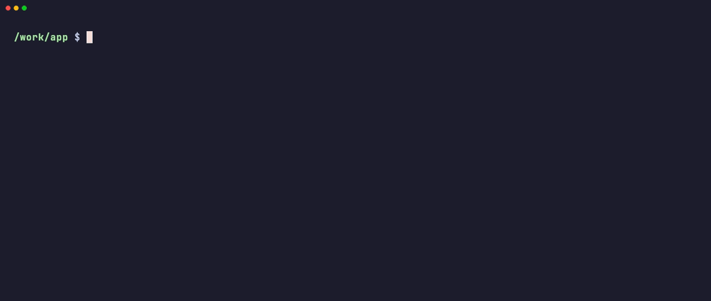
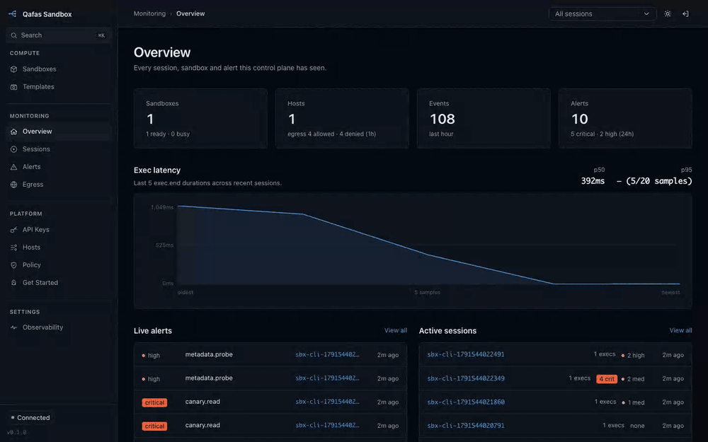

# Qafas Sandbox

Run your LLM coding agent's commands in a sandbox on your own hardware. *Qafas* (قفص) is Arabic for "cage".

- **Contained.** Every command runs in a sandbox with a size it cannot raise and no network except what you allow. The agent and its API keys stay outside.
- **Visible.** A timeline of every process, file and network call, and alerts when something reaches for credentials or tries to break out.
- **Yours.** One control plane and your own worker hosts. No cloud dependency, no phone-home, and every artifact can be carried into an air-gapped site.



**Status: alpha.** The API ([docs/protocol.md](docs/protocol.md)) is stable enough to build on. See [Known limits](#known-limits).

**Contents:** [Quick start](#quick-start) · [Your first sandbox](#your-first-sandbox) · [How it works](#how-it-works) · [Documentation](#documentation) · [Known limits](#known-limits)

## Quick start

Try it on one machine, with the control plane and a worker side by side. Pick one:

| Install | For | Needs |
|---|---|---|
| [Linux packages](#linux-packages) | Ubuntu, Mint, RHEL, Rocky, Alma | x86_64 or arm64; 4 CPUs and 8 GB RAM are plenty to try it |
| [Docker](#docker) | any Linux host with Docker | Docker Engine 26+ with the compose plugin |
| [macOS from source](#macos-from-source) | a developer's Mac | podman, Rust, Go and Node.js |

Running it for a team, or without internet? See [docs/deployment.md](docs/deployment.md) and [docs/airgap.md](docs/airgap.md).

### Linux packages

Validated on Ubuntu 24.04, Linux Mint 22 and Rocky Linux 9.

1. Set the release and download location:

   ```sh
   V=0.3.2                                     # x-release-please-version
   R=https://github.com/exitCodeNihil/qafas-sandbox/releases/download/v$V
   ```

2. Download, verify and install the server and the worker.

   Debian, Ubuntu, Mint:

   ```sh
   A=$(dpkg --print-architecture)              # amd64 | arm64
   curl -fLO $R/qafas-controlplane_$V-1_$A.deb -fLO $R/qafas_$V-1_$A.deb -fLO $R/qafas-cli_$V-1_all.deb -fLO $R/SHA256SUMS
   sha256sum --ignore-missing -c SHA256SUMS
   sudo apt install ./qafas-controlplane_$V-1_$A.deb ./qafas_$V-1_$A.deb
   ```

   RHEL, Rocky, Alma:

   ```sh
   A=$(uname -m)                               # x86_64 | aarch64
   curl -fLO $R/qafas-controlplane-$V-1.$A.rpm -fLO $R/qafas-$V-1.$A.rpm -fLO $R/qafas-cli-$V-1.noarch.rpm -fLO $R/SHA256SUMS
   sha256sum --ignore-missing -c SHA256SUMS
   sudo dnf install ./qafas-controlplane-$V-1.$A.rpm ./qafas-$V-1.$A.rpm
   ```

   `qafas-controlplane` is the server: dashboard, API, and tokens minted at install. `qafas` is the worker: it uses Docker if the host has it, otherwise it installs podman. On one machine the worker joins the control plane by itself.

3. Optional: install the `sbx` CLI. It needs Node.js 22, which Ubuntu 24.04 and RHEL 9 don't ship by default (Ubuntu/Mint: [NodeSource](https://github.com/nodesource/distributions); RHEL 9: `dnf module enable nodejs:22`). Without it, use the container alias from [Docker](#docker).

   ```sh
   sudo apt install ./qafas-cli_$V-1_all.deb           # Debian, Ubuntu, Mint
   sudo dnf install ./qafas-cli-$V-1.noarch.rpm         # RHEL, Rocky, Alma
   ```

4. Check that both services are up, and load your admin token:

   ```sh
   systemctl status controlplane qafas --no-pager
   sudo journalctl -u qafas -n 20 --no-pager           # "serving" with tiers ["vm"]; the first start pulls the ~1.4 GB guest image
   export SBX_URL=http://127.0.0.1:7800 SBX_ADMIN_TOKEN=$(sudo sed -n 's/^SBX_ADMIN_TOKEN=//p' /etc/controlplane/env)
   ```

Next: [your first sandbox](#your-first-sandbox).

### Docker

Needs Docker Engine 26 or later with the compose plugin (`apt install docker.io docker-compose-v2`, or [Docker's packages](https://docs.docker.com/engine/install/)). podman works too: set `CONTAINER_SOCK=/run/podman/podman.sock` in `.env`.

1. Fetch the compose file and generate the tokens:

   ```sh
   V=0.3.2                                     # x-release-please-version
   G=https://raw.githubusercontent.com/exitCodeNihil/qafas-sandbox/v$V/deploy/docker
   mkdir qafas && cd qafas
   curl -fLO $G/compose.yml && curl -fL $G/.env.example -o .env
   for t in SBX_ADMIN_TOKEN SBX_HOST_TOKEN SBX_TOKEN_SECRET; do sed -i "s/^$t=.*/$t=$(openssl rand -hex 24)/" .env; done
   ```

2. Start it, and wait for `egress proxy container up` in the log (the first start pulls the guest image):

   ```sh
   sudo docker compose up -d
   sudo docker compose logs -f qafas
   ```

3. Load your admin token and an `sbx` alias that runs the CLI from its container:

   ```sh
   export SBX_URL=http://127.0.0.1:7800 SBX_ADMIN_TOKEN=$(sed -n 's/^SBX_ADMIN_TOKEN=//p' .env)
   alias sbx='sudo docker run --rm -it --network host -e SBX_URL="$SBX_URL" -e SBX_ADMIN_TOKEN="$SBX_ADMIN_TOKEN" -e SBX_API_KEY="$SBX_API_KEY" -v "$PWD:$PWD" -w "$PWD" ghcr.io/exitcodenihil/qafas-sandbox/sbx:'$V
   ```

The worker mounts `/home` and `/root` at the same paths, so it can see who owns a working directory. Add any other directory people work in to `compose.yml`.

Next: [your first sandbox](#your-first-sandbox).

### macOS from source

```sh
make tools machine                 # Rust targets, zig, and a podman machine with 6 vCPU / 8 GB
make guest-agent image qafas web cp sdk
make dev-local                     # control plane :7800 + worker :7700, native and vm tiers, in the foreground
export SBX_URL=http://localhost:7800 SBX_ADMIN_TOKEN=admin      # in another terminal
```

## Your first sandbox

1. Open the dashboard at `http://<this host>:7800` and sign in with `SBX_ADMIN_TOKEN`. **Hosts** shows the worker and its capacity.

2. Run something from the same machine:

   ```sh
   sbx doctor                                   # can reach the control plane, which tiers are up
   sbx run -- 'uname -a; id; python3 --version' # a throwaway sandbox: create, run, destroy
   sbx shell --keep                             # an interactive shell that outlives your session
   sbx ls                                       # every sandbox the control plane knows
   sbx events <sandbox_id> --follow             # its process, file and network timeline
   ```

3. Give people or agents access. Create an **API key** in the dashboard, choose the sizes and tiers it may use, and hand out `SBX_API_KEY` instead of the admin token. Coding agents plug in through `sbx mcp` or the snippets in `deploy/harnesses/`; see the [TypeScript SDK README](sdk/ts/README.md).

Inside a sandbox you get:

- your current directory, at the **same absolute path**;
- a Debian userland: git, curl, ripgrep, python3 + uv, node 22, headless Chromium;
- no network except what `/etc/qafas/egress.json` allows (`curl https://example.com` works, `curl https://google.com` is refused by the proxy);
- credentials it never holds: an egress **route** gives the sandbox a placeholder, and the proxy swaps in the real token only for the hosts you bound it to, with per-request method and path rules ([deployment guide](docs/deployment.md#7-egress));
- the CPU, memory, disk and process limits of its size.

The dashboard keeps every sandbox's process, file and network timeline, each allow and deny the egress proxy decided, and the alerts. Here, a sandbox reads the planted `~/.aws/credentials` and probes the cloud metadata address:



## How it works

```
 coding agents, sbx CLI, SDKs ──► control plane (server)  :7800   dashboard, API, alerts, SQLite
            │                            │
            │ exec, files, shell         │ create / destroy / metrics
            ▼                            ▼
          worker (agent)  :7700   qafas daemon on each host ──► sandboxes
                                  native · vm (Docker or podman) · remote (Firecracker microVMs)
```

- A **worker** (`qafas`) runs the sandboxes on its own host.
- The **control plane** places them, keeps the history and serves the dashboard.
- Clients ask the control plane for a sandbox, then talk to the worker directly to use it. On one machine both run side by side.

### Isolation tiers

| Tier | Also accepted as | Boundary | Use it for |
|---|---|---|---|
| `native` | `process` | the OS sandbox (Seatbelt on macOS; bwrap, Landlock and seccomp on Linux), sharing the host kernel | fast iteration on trusted code, on a developer's own machine |
| `vm` | `docker` | a container with its own root filesystem (Docker or podman); what stands between it and the host depends on the host, see below | general purpose, and code you do not trust when one team runs it (not hostile code from several tenants) |
| `remote` | `firecracker` | a Firecracker microVM with its own kernel (Linux with KVM) | the strongest isolation: hostile or multi-tenant code, shared hosts |

A request with `trust: untrusted` never runs on `native`.

What `vm` isolates depends on where it runs:

- **macOS:** the container engine is a VM (the podman machine), so a VM boundary separates every sandbox from the Mac. Concurrent sandboxes share that VM's kernel.
- **Linux:** a container on the host's own kernel (namespaces, seccomp, no capabilities, read-only root, no network but the proxy). A kernel exploit inside a sandbox is a host compromise. Set `SBX_VM_RUNTIME` to a sandboxing OCI runtime (gVisor `runsc`, Kata) to put a user-space kernel or a VM in between; `qafas doctor` shows which one is in effect ([deployment guide](docs/deployment.md), [security.md](docs/security.md)).
- Hostile code from several tenants belongs on `remote`. A host that can run Firecracker serves `remote` instead of `vm`, so there `trust: untrusted` lands on a microVM; a Linux host without it sends it to `vm`, a container boundary.

### Sizes

Every sandbox has a size it cannot raise:

| Size | CPUs | Memory |
|---|---|---|
| `micro` | 0.5 | 512 MiB |
| `mini` | 1 | 1 GiB |
| `medium` (default) | 2 | 2 GiB |
| `high` | 4 | 4 GiB |

## Documentation

| Guide | What it covers |
|---|---|
| [docs/deployment.md](docs/deployment.md) | production: separate servers and workers, network and firewall rules, OS permissions, TLS, Firecracker workers, upgrades, backups, monitoring |
| [docs/airgap.md](docs/airgap.md) | installing in a datacenter with no internet, including micro-segmented networks and private registries |
| [TypeScript](sdk/ts/README.md) · [Python](sdk/python/README.md) · [Go](sdk/go/README.md) · [Rust](sdk/rust/README.md) · [Java](sdk/java/README.md) | the SDKs (one package per language, released with the server), the `sbx` CLI, the MCP server and coding-agent integration |
| [SECURITY.md](SECURITY.md) · [docs/security.md](docs/security.md) | reporting a vulnerability · every control in place and every one knowingly deferred |
| [docs/protocol.md](docs/protocol.md) · [docs/decisions.md](docs/decisions.md) | the API contract · why things are the way they are (for contributors) |

## Known limits

- One control plane with SQLite, and no high availability yet. Back up its database ([docs/deployment.md](docs/deployment.md)).
- `native` is for a developer's own machine. On Linux it needs bubblewrap, Landlock and a daemon running as that user (not root); Ubuntu 24.04 and later also need an AppArmor profile for bwrap ([docs/deployment.md](docs/deployment.md)).
- Scratch disk on `vm` and `remote` is RAM-backed, so `disk_mib` is bounded by memory in effect. The mounted workspace has no quota.
- A Firecracker guest keeps its template's RAM; a size above it is refused (`[firecracker] mem_mib`).
- On Docker, a sandbox runs as its workspace's owner (Docker has no idmapped mounts). The workspace must already exist and belong to a regular user; a root-owned one is refused.

## Releases

[Releases](https://github.com/exitCodeNihil/qafas-sandbox/releases) carry the packages, the Firecracker bundle, `images.txt` (every image a version runs) and the scripts that save those images for an air-gapped site. [CHANGELOG.md](CHANGELOG.md) says what changed.

## Building from source

`make tools` · `make guest-agent qafas qafas-linux image rootfs cp web sdk` · `make test` · `make dev-local` · `make bench` · `scripts/package.sh <version>` (deb/rpm). Contributors start with `CLAUDE.md`.

## License

MIT. See [LICENSE](LICENSE).
